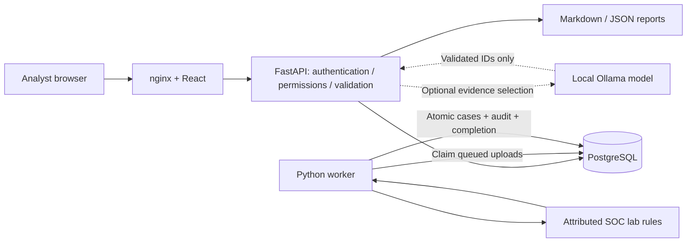

# My design decisions

## Scope and architecture

I chose one trusted analyst workspace. Every authenticated analyst can read all cases and uploads, export reports, comment, change severity, assign any member and perform ordinary status transitions. Assignment is workflow metadata, not an access boundary. Administrators additionally create accounts, inspect the global audit log, retry failed uploads, delete retained input, and close/reopen closed cases. There is no public registration, multi-tenancy or per-case secrecy.

I chose FastAPI with SQLAlchemy, PostgreSQL and Alembic for an explicit API and migration history. React and TypeScript provide the investigation UI. nginx serves the production frontend and proxies `/api` on the same origin. Local HTTP uses a loopback-only port. I used pwdlib's Argon2id password hashing and opaque, cryptographically random session cookies rather than exposing tokens to JavaScript.

## Durable processing

I kept the job queue in PostgreSQL to avoid another infrastructure dependency. A worker claims one queued upload with `SELECT FOR UPDATE SKIP LOCKED`, commits a five-minute lease, computes the correlations, then locks the upload again. It verifies the lease before committing cases, their audit entries and completion together. Multiple workers cannot claim the same row simultaneously. If computation fails, the transaction rolls back and the worker records a generic failure. A dead worker's lease becomes a visible failure when another worker polls; an administrator can explicitly retry it. A late worker with an obsolete lease cannot publish results.

I chose explicit retry rather than infinite automatic retries. This makes failure visible and avoids a poison upload repeatedly consuming resources. There is no worker heartbeat or automatic lease extension: a job exceeding five minutes requires review. A database outage causes a generic worker retry message without logging payloads or credentials.

## Correlation and duplicates

I validate UTF-8 JSONL before queuing it, with a 5 MiB limit, 10,000-line limit, bounded fields, timezone-aware timestamps and rejected unknown keys. I normalize timestamps to UTC, event IDs, JSON key order and row order, and remove identical rows before hashing. A database unique constraint on that canonical SHA-256 hash makes concurrent duplicate uploads conflict instead of enqueueing twice. Whitespace and line ordering do not bypass deduplication. Overlapping but non-identical uploads can create related cases; I do not merge cases across uploads.

I group by exact host and case-insensitive username into fixed windows measured from each window's first event. A window spans at most 30 minutes. Evidence IDs are stable within the normalized upload (`U1-E0001`), not original file line numbers. Cases retain all context records in their window; detection links identify the narrower supporting subset. The sample produces one case with five findings and 13 context records; a separate benign host does not create a case.

## Investigation state

I use `open → investigating → resolved → closed`. Analysts can move investigating cases back to open and resolved cases back to investigating. Only administrators can close resolved cases or reopen closed ones. Case updates lock the row and require its current version. Concurrent edits fail with a conflict instead of silently overwriting a decision. Audit entries record actor, before/after values and time in the same transaction. Notes are append-only through the API.

## Authentication

Sessions last eight hours, are stored as SHA-256 token hashes, and are revoked on logout. Cookies are HttpOnly and SameSite=Strict. Secure cookies default on in the backend; the loopback HTTP demo explicitly turns Secure off. All protected mutations require a session-bound CSRF header. nginx supplies a restrictive content security policy; React displays evidence and comments as text. Markdown exports escape HTML and Markdown metacharacters in untrusted content.

I use a database-backed 20-attempt/five-minute throttle by direct peer IP. nginx shares one backend peer IP, so this conservatively throttles the entire Compose demo together. This is appropriate for a local portfolio demo, but needs a trusted proxy-aware limiter before any shared deployment. I deliberately do not trust arbitrary forwarded headers.

## AI assistance

The application needs no AI key. Its default draft is a deterministic summary of source-record fields with evidence citations and explicit uncertainty. An opt-in local Ollama model can select and order evidence IDs from a bounded catalog. I validate that selection against a strict schema and known IDs, then render factual sentences from the original records. The model cannot invent a narrative, execute a tool, change a case, or perform containment. Provider errors, unknown IDs or malformed output fall back to the local template.

I limit drafts to fit within an analyst note. The user must explicitly choose “I reviewed the evidence” to save a draft as a note; exports include saved notes, not unreviewed transient drafts. This is a review workflow, not a claim that software can verify a human's attention. The local-provider adapter is tested with controlled responses; I have not benchmarked a real model's selection quality.
